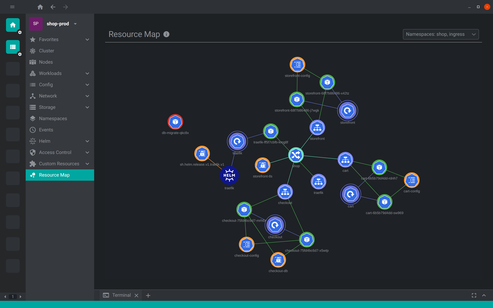
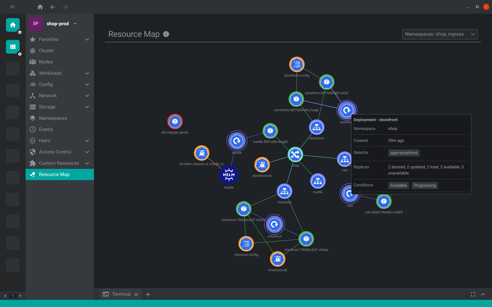
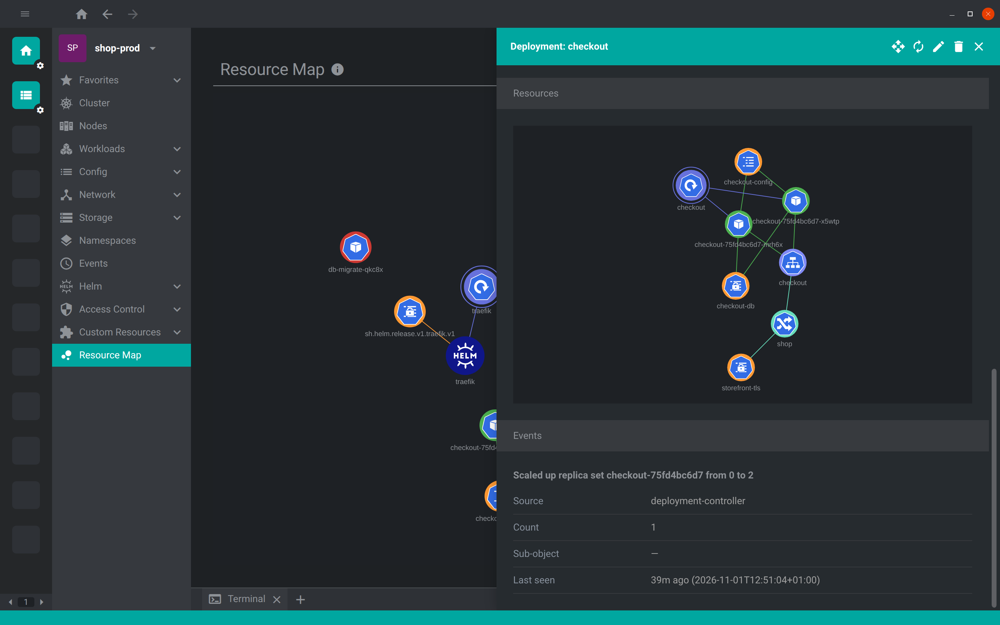
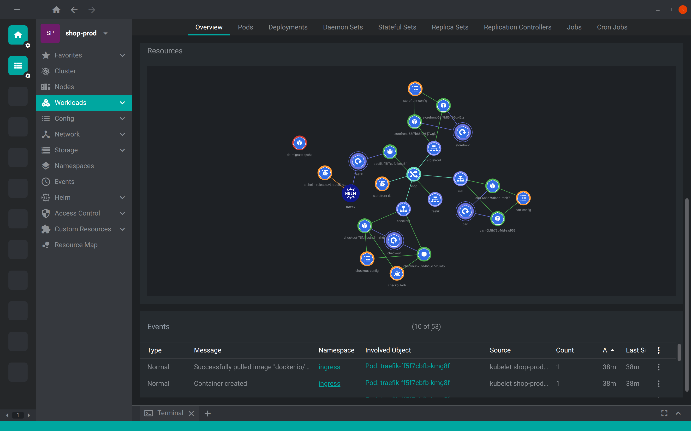

# @freelensapp/resource-map-extension

[](https://freelens.app)
[](https://github.com/freelensapp/freelens-resource-map-extension)
[](https://github.com/freelensapp/freelens-resource-map-extension/releases)
[](https://github.com/freelensapp/freelens-resource-map-extension/actions/workflows/unit-tests.yaml)
[](https://github.com/freelensapp/freelens-resource-map-extension/actions/workflows/integration-tests.yaml)
[](https://www.npmjs.com/package/@freelensapp/resource-map-extension)

## Overview

[Freelens](https://freelens.app) extension that draws the resources of a
Kubernetes cluster, and the links between them, as a live graph: the pods,
the workloads that run them, the Services in front of them and the Ingresses
in front of those, the ConfigMaps, Secrets and PersistentVolumeClaims that
the pods use, and the Helm releases that installed them. The graph follows
the cluster while it is open, and a click on a node opens its object in
Freelens.

The graph is in three places: the **Resource Map** page of the cluster
sidebar, for the namespaces that the namespace filter selects; the
**Resources** panel of **Workloads** > **Overview**; and a map of the objects
related to one object in the details of a Deployment, DaemonSet, StatefulSet,
Pod, Service or Ingress. The extension reads the cluster through the stores
of Freelens and its connection to the cluster, and changes nothing in it:
every request it makes is a list or a watch.

[Video Demo](https://github.com/user-attachments/assets/d9713d0b-e324-4cf8-8b6d-44a89d5374e8)









### Authors

- [Lauri Nevala](https://github.com/nevalla) created the extension.
- [Yasmine Gharbi](https://github.com/GHARBIyasmine) adapted and updated it
  for Freelens, and maintains it.
- [Omar Alani](https://github.com/omarluq) moved it to pnpm and automated its
  releases in
  [#5](https://github.com/freelensapp/freelens-resource-map-extension/pull/5).
- The Freelens team ported it to the extension API of Freelens 2 in
  [#43](https://github.com/freelensapp/freelens-resource-map-extension/pull/43).

## Requirements

- Freelens 2.0.0 or a later 2.x (extension API v2). Freelens 1.6 or a later
  1.x needs version 1.0.2 of the extension.
- Kubernetes >= 1.24
- Permission to list and watch, in the namespaces to draw, the kinds of
  [Supported resources](#supported-resources). A kind that the user may not
  list is left out, and the maps draw the others (see [Limits](#limits)).

## Supported resources

| Resource                | API version            | Linked to                                                  |
| ----------------------- | ---------------------- | ---------------------------------------------------------- |
| `Pod`                   | `v1`                   | the ConfigMaps, Secrets and PersistentVolumeClaims it uses |
| `Deployment`            | `apps/v1`              | its pods and its Helm release                              |
| `StatefulSet`           | `apps/v1`              | its pods and its Helm release                              |
| `DaemonSet`             | `apps/v1`              | its pods and its Helm release                              |
| `Service`               | `v1`                   | the pods that its selector matches                         |
| `Ingress`               | `networking.k8s.io/v1` | the Services of its backends and its TLS Secrets           |
| `PersistentVolumeClaim` | `v1`                   |                                                            |
| `ConfigMap`             | `v1`                   |                                                            |
| `Secret`                | `v1`                   | its Helm release, for a release Secret                     |

A pod uses a ConfigMap or a Secret that its containers read with `envFrom`, a
Secret that they read with a `secretKeyRef`, and a ConfigMap, a Secret or a
PersistentVolumeClaim that it mounts as a volume. A Helm release is no object
of the cluster: the maps know it from the labels and annotations that Helm
sets on the objects it installs, and from its release Secrets.

## Install

Open Freelens and go to Extensions (`ctrl`+`shift`+`E` or
`cmd`+`shift`+`E`). The field at the top takes a package name, the URL of a
tarball, or the path to a tarball or a directory.

### From the registry

Enter `@freelensapp/resource-map-extension` and press Install.

Alternatively, open the following URL in the browser to install directly:

[freelens://app/extensions/install/%40freelensapp%2Fresource-map-extension](freelens://app/extensions/install/%40freelensapp%2Fresource-map-extension)

### From a release tarball

Each [release](https://github.com/freelensapp/freelens-resource-map-extension/releases)
has the extension as `freelensapp-resource-map-extension-<version>.tgz`, and
from 2.0.0 on its checksum in
`freelensapp-resource-map-extension-<version>.tgz.sha256`. Use a release
whose major version matches your Freelens version, 1.0.2 for Freelens 1.x.

- Enter the URL of the `.tgz` asset and press Install. Freelens downloads the
  `.tgz.sha256` next to it and checks the tarball against it.
- Or download both files into one directory and enter the path to the `.tgz`,
  or drop the `.tgz` on the Freelens window. Freelens checks it against the
  `.tgz.sha256` next to it.

### From a directory

Build the extension (see below), then enter the path to your checkout, the
directory with `package.json`, and press Install. Freelens runs the extension
from that directory, from the files in `dist/`, and lists it as unverified.
This is how you work on the extension: see
[Development loop](#development-loop).

## Getting started

1. Connect Freelens to a cluster and select **Resource Map** in its sidebar.
2. Select the namespaces to draw in the namespace filter at the top right.
   Freelens keeps the selection for every list of the cluster.
3. Hover a node to see its object, and click it to open its details, where
   **Resources** holds a map of the objects related to it.

## Features

### The Resource Map page

The page draws the objects of the namespaces that the namespace filter
selects, and the links between them. A ConfigMap is drawn only when a pod
uses it, a TLS Secret only when an Ingress names it, and the token Secret of
a service account only when something other than a volume points to it. The
info icon next to the title shows the legend, with the icon and the name of
every kind.

The graph is force-directed: linked objects pull together, and the others
push apart. Scroll to zoom, drag the background to pan, and drag a node to
move it.

### The Workloads Overview panel

**Workloads** > **Overview** has a **Resources** panel with the same graph,
for the same namespaces, next to the other panels of the overview.

### The maps in the details

The details of an object of these kinds have a map of the objects related to
it in its namespace, under **Resources**:

- a Deployment, a DaemonSet or a StatefulSet: its pods, with their Secrets,
  ConfigMaps and claims, its Helm release, the Services that select the pods,
  and the first Ingress in front of those Services;
- a Pod: its Secrets, ConfigMaps and claims, the Services that select it, its
  controller with its Helm release, and the first Ingress in front of those
  Services;
- a Service: the pods it selects, with the other Services that select them
  and their controllers, and the Ingresses whose backends name it;
- an Ingress: its TLS Secrets, the Services of its backends, and the pods
  they select, with the other Services that select them and their
  controllers.

The map is there also when the namespace filter does not select the
namespace of the object, as for a pod opened from a link: the map then lists
that namespace itself.

### Live, and linked to Freelens

- The maps follow the cluster: a new pod, a deleted object or a pod that
  fails shows on the graph without a reload.
- Every kind has its color and icon. Deployments, StatefulSets and DaemonSets
  have an outer ring, and a pod takes the color of its phase: green when it
  runs or has succeeded, grey while it terminates, dark while it is pending,
  red when it has failed.
- Hovering a node shows a tooltip with its object, such as the selector and
  the replicas of a Deployment, the status and the containers of a pod, or
  the hosts, paths and backends of an Ingress, and draws its links thicker.
- A click on a node opens the details of its object in Freelens, and a click
  on a Helm release opens the release under **Helm** > **Releases**.

## Limits

- Some references give no link: a `configMapKeyRef`, a projected volume, an
  init container and the default backend of an Ingress
  (`spec.defaultBackend`). An Ingress with only a default backend links to
  nothing.
- In the maps of a Service and of an Ingress, a pod links to no ConfigMap,
  Secret or claim.
- In the maps of a pod, a Service and an Ingress, a pod that no StatefulSet
  or DaemonSet owns gets as its Deployment the first one of its namespace
  whose `matchLabels` it carries all; `matchExpressions` are not read.
- In the maps of a workload and of a pod, only the first Ingress in front of
  their Services gets a node, and the links of the later ones start from it.
- A pod takes the color of its phase, so a pod whose containers restart in a
  loop is still running, and stays green.
- A user who may not list a kind gets maps without it. With the `view` role
  of Kubernetes, which reads no Secret, the maps have no Secrets, and a Helm
  release is known only from the labels and annotations of its workloads.
- On the page and in the panel, the message "No visualizable resources found
  in this namespace." stays until the selection changes, also when objects
  are created in those namespaces in the meantime.

## Build from the source

### Prerequisites

Use [NVM](https://github.com/nvm-sh/nvm),
[mise-en-place](https://mise.jdx.dev/), or
[windows-nvm](https://github.com/coreybutler/nvm-windows) to install the
Node.js version in `.nvmrc`.

From the root of this repository:

```sh
nvm install
# or
mise install
# or
winget install CoreyButler.NVMforWindows
nvm install "$(cat .nvmrc)"
nvm use "$(cat .nvmrc)"
```

Install pnpm:

```sh
corepack install
# or
curl -fsSL https://get.pnpm.io/install.sh | sh -
# or
winget install pnpm.pnpm
```

### Build extension

```sh
pnpm install
pnpm build
```

The extension is built into `dist/`. To pack it into a tarball:

```sh
pnpm pack
```

One script to bump the prerelease version, build and pack the extension for
testing:

```sh
pnpm pack:dev
```

The tarball is placed in the current directory. Install it as described in
[From a release tarball](#from-a-release-tarball).

### Development loop

Install the extension from your checkout once, as described in
[From a directory](#from-a-directory), then run:

```sh
pnpm dev
```

It rebuilds the extension whenever a source file changes, and Freelens
reloads the extension after each rebuild, without a restart and without
packing. Stop it with `ctrl`+`C`.

Neither `pnpm build` nor `pnpm dev` type-checks; run `pnpm type:check` for
that. A change to `main` or `renderer` in `package.json` needs Freelens
restarted once.

To check the extension in Freelens with an AI agent, see "Checking the
Extension in Freelens Dev" in [AGENTS.md](AGENTS.md).

### Check the code

```sh
pnpm type:check
pnpm test:unit
pnpm lint:check
pnpm knip:check
```

and, for the formats that Biome does not cover:

```sh
pnpm trunk:check
```

### Integration tests

The integration tests drive Freelens dev, started from a
[freelensapp/freelens](https://github.com/freelensapp/freelens) checkout,
against a [kind](https://kind.sigs.k8s.io/) cluster. In the Freelens checkout:

```sh
pnpm dev
```

Freelens dev lists no cluster until a kubeconfig is added in Preferences >
Kubernetes > Kubeconfig Syncs. Add one with the kind cluster, for example:

```sh
kubectl config view --minify --flatten --context kind-kind > ~/kind-kind.kubeconfig
```

The tests expect the test objects and the local Helm chart of
`integration/fixtures/` in the kind cluster, as the workflow installs them:

```sh
kubectl --context kind-kind apply -f integration/fixtures/resource-map
helm --kube-context kind-kind upgrade --install catalog integration/fixtures/charts/catalog \
  --namespace shop --wait --timeout 180s
```

Then, with the kind cluster running, in the extension repository:

```sh
pnpm build
pnpm test:integration
```

The tests install the checkout in place, replacing any other installation of
the extension in Freelens dev, then open the Resource Map page, the
Workloads Overview and the details of the test objects, each first in a
session of its own. They change nothing in the cluster. Without Freelens dev
or the cluster they are skipped.

Optional variables:

- `TEST_KIND_CLUSTER_NAME`: the kind cluster, `kind` by default, used
  through the context `kind-<name>`.
- `FREELENS_CDP_URL`: the CDP endpoint of Freelens dev,
  `http://127.0.0.1:9223` by default.
- `FREELENS_MAIN_LOG`: a log of the main process to check for errors, such
  as its `lens.log`. Without it only the renderer's errors are checked.

### Testing the extension with unpublished Freelens

In the Freelens working repository:

```sh
rm -f *.tgz
pnpm i
pnpm build
pnpm pack -r
```

Then in the extension repository:

```sh
echo "overrides:" >> pnpm-workspace.yaml
for i in ../freelens/*.tgz; do
  name=$(tar zxOf $i package/package.json | yq -r .name)
  echo "  \"$name\": $i" >> pnpm-workspace.yaml
done

pnpm clean:node_modules
pnpm build
```

## License

Copyright (c) 2021 [Lauri Nevala](https://github.com/nevalla), 2025-2026
[Yasmine Gharbi](https://github.com/GHARBIyasmine) and 2026 Freelens Authors.

[MIT License](LICENSE)
