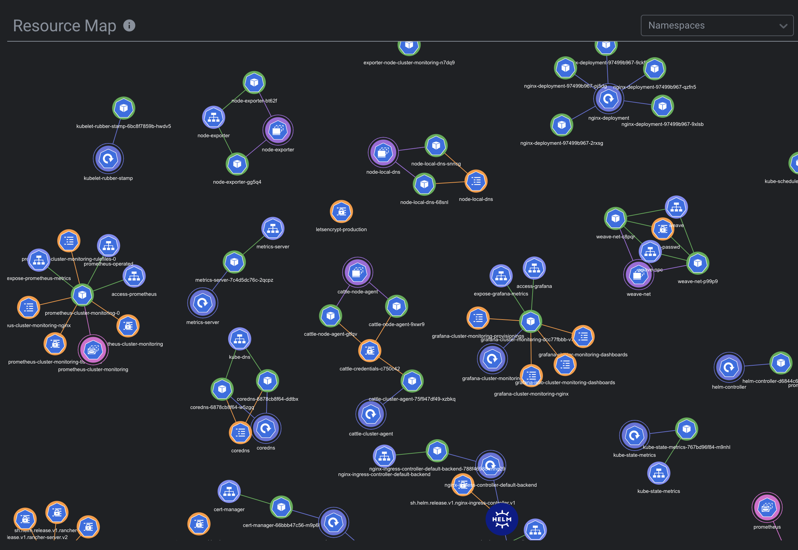

# @freelensapp/resource-map-extension

[](https://freelens.app)
[](https://github.com/freelensapp/freelens)
[](https://github.com/freelensapp/freelens-resource-map-extension)
[](https://github.com/freelensapp/freelens-resource-map-extension/actions/workflows/integration-tests.yaml)


## Overview 

The following is a description from the original repo :

"Lens Resource Map is an extension for [Lens - The Kubernetes IDE](https://k8slens.dev) that displays Kubernetes resources and their relations as a real-time force-directed graph."




## Features

- Interactive graph visualization of Kubernetes resources
- Resource relationship mapping (pods, services, deployments, etc.)
- Namespace filtering
- Visual indicators for resource status and health
- Click navigation to resource details
- Access the resource map from its own dedicated tab or directly within the cluster's workload overview
- See a focused mini-map of related resources when viewing details of a specific resource

## Requirements

- Freelens 2.0.0 or a later 2.x (extension API v2). Freelens 1.6 or a later
  1.x needs version 1.0.2 of the extension.
- Kubernetes >= 1.24

## Install

Open Freelens and go to Extensions (`ctrl`+`shift`+`E` or
`cmd`+`shift`+`E`). The field at the top takes a package name, the URL of a
tarball, or the path to a tarball or a directory.

### From the registry

Enter `@freelensapp/resource-map-extension` and press Install.

Alternatively, open the following URL in the browser to install directly:

[freelens://app/extensions/install/%40freelensapp%2Fresource-map-extension](freelens://app/extensions/install/%40freelensapp%2Fresource-map-extension)

### From a release tarball

Each [release](https://github.com/freelensapp/freelens-resource-map-extension/releases)
has the extension as `freelensapp-resource-map-extension-<version>.tgz`, and
from 2.0.0 on its checksum in
`freelensapp-resource-map-extension-<version>.tgz.sha256`. Use a release
whose major version matches your Freelens version, 1.0.2 for Freelens 1.x.

- Enter the URL of the `.tgz` asset and press Install. Freelens downloads the
  `.tgz.sha256` next to it and checks the tarball against it.
- Or download both files into one directory and enter the path to the `.tgz`,
  or drop the `.tgz` on the Freelens window. Freelens checks it against the
  `.tgz.sha256` next to it.

### From a directory

Build the extension (see below), then enter the path to your checkout, the
directory with `package.json`, and press Install. Freelens runs the extension
from that directory, from the files in `dist/`, and lists it as unverified.
This is how you work on the extension: see
[Development loop](#development-loop).

## Build from the source

### Prerequisites

Use [NVM](https://github.com/nvm-sh/nvm),
[mise-en-place](https://mise.jdx.dev/), or
[windows-nvm](https://github.com/coreybutler/nvm-windows) to install the
Node.js version in `.nvmrc`.

From the root of this repository:

```sh
nvm install
# or
mise install
# or
winget install CoreyButler.NVMforWindows
nvm install "$(cat .nvmrc)"
nvm use "$(cat .nvmrc)"
```

Install pnpm:

```sh
corepack install
# or
curl -fsSL https://get.pnpm.io/install.sh | sh -
# or
winget install pnpm.pnpm
```

### Build extension

```sh
pnpm install
pnpm build
```

The extension is built into `dist/`. To pack it into a tarball:

```sh
pnpm pack
```

One script to bump the prerelease version, build and pack the extension for
testing:

```sh
pnpm pack:dev
```

The tarball is placed in the current directory. Install it as described in
[From a release tarball](#from-a-release-tarball).

### Development loop

Install the extension from your checkout once, as described in
[From a directory](#from-a-directory), then run:

```sh
pnpm dev
```

It rebuilds the extension whenever a source file changes, and Freelens
reloads the extension after each rebuild, without a restart and without
packing. Stop it with `ctrl`+`C`.

Neither `pnpm build` nor `pnpm dev` type-checks; run `pnpm type:check` for
that. A change to `main` or `renderer` in `package.json` needs Freelens
restarted once.

To check the extension in Freelens with an AI agent, see "Checking the
Extension in Freelens Dev" in [AGENTS.md](AGENTS.md).

### Check the code

```sh
pnpm type:check
pnpm test:unit
pnpm lint:check
pnpm knip:check
```

and, for the formats that Biome does not cover:

```sh
pnpm trunk:check
```

### Integration tests

The integration tests drive Freelens dev, started from a
[freelensapp/freelens](https://github.com/freelensapp/freelens) checkout,
against a [kind](https://kind.sigs.k8s.io/) cluster. In the Freelens checkout:

```sh
pnpm dev
```

Freelens dev lists no cluster until a kubeconfig is added in Preferences >
Kubernetes > Kubeconfig Syncs. Add one with the kind cluster, for example:

```sh
kubectl config view --minify --flatten --context kind-kind > ~/kind-kind.kubeconfig
```

The tests expect the test objects and the local Helm chart of
`integration/fixtures/` in the kind cluster, as the workflow installs them:

```sh
kubectl --context kind-kind apply -f integration/fixtures/resource-map
helm --kube-context kind-kind upgrade --install catalog integration/fixtures/charts/catalog \
  --namespace shop --wait --timeout 180s
```

Then, with the kind cluster running, in the extension repository:

```sh
pnpm build
pnpm test:integration
```

The tests install the checkout in place, replacing any other installation of
the extension in Freelens dev, then open the Resource Map page, the
Workloads Overview and the details of the test objects, each first in a
session of its own. They change nothing in the cluster. Without Freelens dev
or the cluster they are skipped.

Optional variables:

- `TEST_KIND_CLUSTER_NAME`: the kind cluster, `kind` by default, used
  through the context `kind-<name>`.
- `FREELENS_CDP_URL`: the CDP endpoint of Freelens dev,
  `http://127.0.0.1:9223` by default.
- `FREELENS_MAIN_LOG`: a log of the main process to check for errors, such
  as its `lens.log`. Without it only the renderer's errors are checked.

### Testing the extension with unpublished Freelens

In the Freelens working repository:

```sh
rm -f *.tgz
pnpm i
pnpm build
pnpm pack -r
```

Then in the extension repository:

```sh
echo "overrides:" >> pnpm-workspace.yaml
for i in ../freelens/*.tgz; do
  name=$(tar zxOf $i package/package.json | yq -r .name)
  echo "  \"$name\": $i" >> pnpm-workspace.yaml
done

pnpm clean:node_modules
pnpm build
```

## License

This project is licensed under the MIT License.  
Original work © [Lauri Nevala](https://github.com/nevalla) [ [kube-resource-map](https://github.com/nevalla/lens-resource-map-extension) ]

Freelens adaptation and initial update © 2025-2026 [Yasmine Gharbi](https://github.com/GHARBIyasmine)

Maintained collaboratively under the [Freelens](https://github.com/freelensapp) organization.
